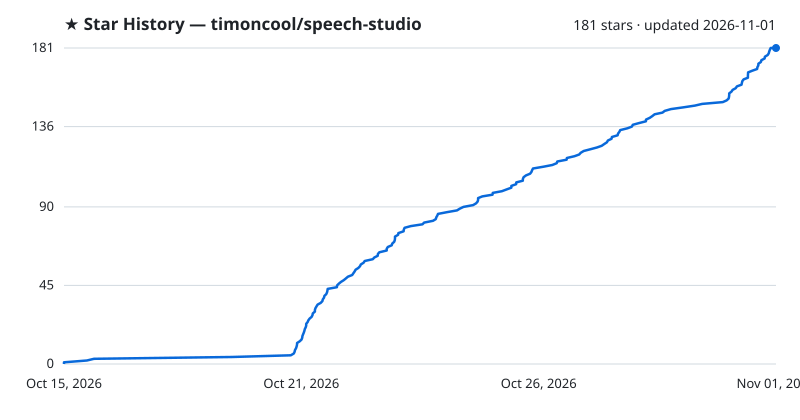

<div align="center">


# Speech Studio

**免费、离线的 AI 语音工作室，支持 Windows、macOS（Apple silicon）和 Linux——用克隆声音和内置声音为任意文本配音，把录音转成带说话人的文字。俄语处理到位：数字按格变化、重音、«ё» 与同形异音词。100% 本地运行，零 Python：一个原生程序（Rust + C++，运行于 CUDA、Vulkan 或 Metal）；每个模型和引擎一键下载。**

[](LICENSE)
[](https://github.com/timoncool/speech-studio/stargazers)
[](https://github.com/timoncool/speech-studio/releases)
[](https://github.com/timoncool/speech-studio/releases)
[](https://github.com/timoncool/speech-studio/commits)

[English](README.md) · [Русский](README.ru.md) · **中文** · [Español](README.es.md) · [Português](README.pt.md) · [Français](README.fr.md)


</div>

## 这是什么

**Speech Studio** 有三种模式。**Speech** 为文本配音：一句话、每个角色各有声音的对话、由“导演”为你写好的播客，或者来自 EPUB、FB2、PDF、DOCX 的整本书。**Listening** 把录音、视频或链接转成文字，标明谁在什么时候说了什么，可以按文字剪辑，可以把配音与应有的文本逐词核对，还能从说话人生成声音库里的声音。**Live** 是与通过 MCP 连接的 AI 智能体进行语音对话：它写出一句就立刻说出一句，并通过麦克风听你说话。

一切都**在你的电脑上本地运行**——无云端、无订阅；你的文本、录音和声纹不会离开电脑。如果想用显卡跑不动的声音，也可以使用 **OpenRouter**、**Google Gemini**、**fal.ai** 和 **Runware** 的云端声音，每个都有自己的密钥，第一次调用前会请你确认；默认关闭。

这是一个**完全原生的程序**：没有内嵌 Python、没有 torch、没有 CUDA wheel。整个工作室是 **Rust + 原生 C++ 引擎（GGUF/ONNX），运行于 CUDA、Vulkan 或 Metal**。模型、引擎、CUDA 与 VC++ 运行库和 ffmpeg 在首次运行时**由程序自己下载**；作者其他工作室里已有的模型会直接拿来用，不再重复下载。**本程序为 NVIDIA 显卡构建并测试**；其他情况见“各阶段在哪里运行”。

## 给 AI 智能体

Speech Studio 打开时，会在 `http://127.0.0.1:8797/mcp` 提供 MCP：Claude Code、Claude Desktop、Cursor、Codex 等智能体可以用同一套代码完成窗口能做的一切——一次调用把文本配成文件、逐块创建和编辑项目、给角色分配声音、按描述设计声音、识别并核对录音、导出带章节和字幕的有声书。设置里的 **智能体 (MCP)** 显示是否已连接，以及要粘贴到客户端的内容。智能体唯一不能做的是打开麦克风：Live、录音和麦克风测试只会在你亲手点击或按键时开始。

1. 从[最新发布](https://github.com/timoncool/speech-studio/releases/latest)安装并启动工作室。
2. 连接它的 MCP 服务器：
   ```bash
   claude mcp add --transport http speech-studio http://127.0.0.1:8797/mcp
   ```
   其他客户端：`{ "mcpServers": { "speech-studio": { "type": "streamable-http", "url": "http://127.0.0.1:8797/mcp" } } }`
3. 阅读服务器提供的技能说明（资源 `studio://skill`，与 [docs/mcp-skill.md](docs/mcp-skill.md) 内容相同），从工具 `studio_status` 开始。

同一端口上还提供 OpenAI 音频 API——`POST /v1/audio/speech`、`POST /v1/audio/transcriptions`、`GET /v1/models`——为 OpenAI 编写的工具可直接通过它配音和识别，`voice` 填声音库中的声音名称。[llms.txt](llms.txt) 为寻找它的工具提供同样的信息。只有本机上的程序可以连接。

## 能用它做什么

- **有声书**——拖入 EPUB 或 FB2：分章、角色各有声音、带章节和封面的 M4B，并检查 ACX 响度。
- **播客或对话**——“导演”为两到三位说话人写一期主题播客，或粘贴“安娜：……”这样的台词；时间线显示每一处重叠。
- **视频配音**——把脚本或字幕配进各自的时间点，在多轨编辑器里铺上音乐和音效，按视频响度导出。
- **采访或讲座的文字稿**——谁在何时说了什么、每个词的时间、按播出机构规则的字幕、按文字剪辑录音。
- **核对配音**——把脚本对到录音上，看到每个读错或漏读的词。
- **你自己的声音库**——录制或导入声音并清理，从录音里的说话人生成声音。
- **给你的 AI 智能体一副嗓子**——在 Live 中与 Claude Code 或任何 MCP 智能体语音对话，或让它通过 MCP 或兼容 OpenAI 的 API 配音和识别文件。

所有引擎和声音的示例，以及俄语重音的前后对比，见[项目页面](https://timoncool.github.io/speech-studio/zh.html)。

## 三种模式

| 模式 | 作用 |
|------|--------------|
| 🔊 **Speech** | 文本、对话、播客或书 → 带多个版本的配音块，逐句听审，导出为 WAV、FLAC、MP3、OGG、M4A 或带章节的 M4B，附字幕和同步文本 |
| 👂 **Listening** | 音频、视频或链接 → 带说话人和逐词时间的文字稿，卡拉 OK 播放器，按文字剪辑，导出 SRT、VTT、ASS、TXT 或 JSON，与参考文本核对 |
| 🎙️ **Live** | 与 AI 智能体语音对话：通过 MCP 连接的智能体每写完一句就立即说出，你对着麦克风回答并逐句识别，说一句话就能打断它；麦克风只能由你打开，按 M 或 Ctrl+Shift+空格暂停，悬浮在所有窗口之上的小组件 |

## 功能

**声音与引擎**

- **六个本地引擎**——[Higgs Audio v3](https://huggingface.co/bosonai)（克隆、情绪和声音效果）、**Fish Audio Drama 3**（最强的开源声音；24 GB 显卡可整体加载，6 GB 起专家放在内存中）、**Audio8 TTS**（23 种语言的自然语音，克隆或模型自带声音）、**Supertonic 3**（快速，十个内置声音）、**Qwen3-TTS 1.7B**（九个内置声音、克隆、每块一条指令）以及**带俄语重音的 Qwen3-TTS**（运行时加载 siriusfreak 的 LoRA）。
- **角色和块可以有自己的引擎**，覆盖项目引擎；不能说当前声音的引擎会告诉你它会改用哪个内置声音。
- **声音库**——一键导入声音包、云端目录中的 743 个俄语声音、麦克风录音、导入文件和 ZIP、照片、性别、年龄、语言、标签和授权说明；参考音频的文本只识别一次并保存。
- **清理参考音频**——Mel-Band Roformer 把人声从音乐中分离，**DPDFNet** 去除噪声并可调节强度，让语音保持自然；原始文件会保留。
- **参考音频的最佳片段**——按识别出的词之间的停顿切窗，每个窗口给出长度、信噪比、削波和最长停顿。
- **按描述生成声音**——Qwen3-TTS VoiceDesign 根据“一位声音柔和、略带沙哑的老奶奶……”生成声音：试听多个候选，把最好的保存到声音库。

- **云端声音**——OpenRouter、Google Gemini（并行请求或半价的 Batch）、fal.ai 和 Runware，各自使用自己的密钥，首次调用前需确认。

**听起来正确的文本**

- **俄语规范化**——数字按正确的格和性、日期、时间、货币、单位、罗马数字、拉丁字母品牌名和缩写。
- **RUAccent 处理重音、«ё» 和同形异音词**——大号同形词模型（int8 的 big_poetry，选择与 fp32 一致）根据句子判断；有疑问的会高亮供你选择，你自己的 `+` 不会被改动。
- **发音词典**——替换、正则和音素，作用范围可为项目、语言、声音或引擎，可导入 Balabolka 的 `.rex`/`.dic`/`.bxd`，并能在词典里直接试听规则。
- **兼容 SpeechKit 的标记**——`+` 重音、`sil<[300]>` 和 `[pause 500ms]` 停顿、`[rate:1.2]` 语速、`**重读**`；引擎不理解的内容会被标出，而不是悄悄丢掉。

- **更多文本读得正确**——SSML 子集、逐词着色的韵律提示、电话号码、邮箱和代码、用同一声音朗读的外语片段，以及配音前的脚本检查。

**项目**

- **文本即时间轴**——带说话人的块、多个版本（最多五个）、过期追踪、撤销重做、拖动排序、支持正则的查找替换、注释和标记。
- **质量控制**——每个版本都会被反向识别并逐词比对，另有削波、静音、截断、结尾咔哒声、重复短语、长尾音、音乐或噪声代替语音、与参考声音相似度等检查；多版本自动选出最佳。
- **对话和播客**——`Anna:` 和 `[Anna]` 行会变成角色，导演为 N 个说话人按主题写播客，负停顿形成插话，**时间轴**显示每处重叠，可选择截断、接续或保留。
- **有声书**——EPUB、FB2、PDF、DOCX、HTML、Markdown 和 TXT，章节预览、导演按角色分配、带章节和封面的 M4B、长书分卷、ACX 响度检查。
- **字幕即项目**——SRT、VTT 和 ASS 的台词配到各自的时间段：预先提高语速，不合适的版本会重试，然后再加速并借用台词前的静音。
- **导出前检查**——导出前列出缺音频、过期、失败、文件被改动或比台词更长的块；只有时长不符可以放行。
- **响度**——视频（−14 LUFS）、播客（−16 LUFS）和 ACX 预设，带 true-peak 限幅器、房间底噪和块之间的呼吸声。
- **项目文件**——`.speechproj` 包含文本、声音和音频，可把项目带到另一台电脑。

- **剪辑**——文本下方的多轨编辑器：移动、裁剪、淡入淡出和调整每个片段的音量，来自文件或文件夹的音乐和音效轨，或直接在 YuE2、MiniMax Music3、ACE-Step Studio 中生成的歌曲。
- **满足各种用途的导出**——每章一个文件、每个角色一条音轨打包为 ZIP、CSV 台词表、声音效果（对讲机、电话、扩音器）、片段响度一致、采样率与位深、文件名模板、SHA-256 清单以及制作说明。
- **比较与确认**——录音的 A/B 对比、同一文本上的引擎盲测、重新配音时不会改动的已确认块、质量红绿灯和项目报告。
- **书籍与剧本**——直接引语与旁白分开、为角色挑选声音的角色表、清理脚注、把书中的名字加入词典、从修正后的书更新项目而不丢失已配音内容，以及书的 HTML 播放器。

**Listening**

- **audio.cpp 上的 Parakeet-TDT v3、Nemotron 3.5（28 种语言，带标点）和 CrisperWhisper 2.0 turbo（99 种语言，带词时间），transcribe.cpp 上的 Parakeet Ultra**，通过 Nemotron 3 Diarization 区分最多八个说话人，长录音由 **Silero VAD v6** 按停顿切分，DPDFNet 去噪，Roformer 去音乐。
- **给 CrisperWhisper 的提示**——主题和术语写法，加上你添加的更正。
- **批量**——一次拖入多个文件，每个都会成为排队识别的录音。
- **把已知文本铺到录音上**——参考文本逐句获得每个被听到的词的时间。
- **从说话人生成声音**——用每个说话人最清晰的词生成声音库声音。

- **边说边识别**——从麦克风逐句识别、后台识别监视的文件夹、无需编辑器的快速识别。
- **自动选对模型**——语言设为“自动”时由 VoxLingua107 判断语言，录音交给懂这门语言的识别模型；所选模型在首次使用时下载。
- **按播出机构规则生成字幕**（Netflix、BBC 等）、谁说了多少、导出时数字用阿拉伯数字。

**Live**

- **语音对话**——通过 MCP 连接的智能体写出一句就说出一句；你对着麦克风回答，逐句被识别；你说出至少两个词的一句话会打断智能体，咳嗽、笑声或“嗯”则不会；输入的文字也会像说出的话一样传给智能体。
- **随时更换**——智能体的声音、识别模型、语言和麦克风都能在对话中途更换，由你更换或由智能体按你的要求更换：识别模型就地切换，换麦克风或语言会让麦克风重新开始，新声音的引擎加载时窗口显示“正在加载声音…”。
- **自然的节奏**——智能体的句子在 300 个字符以内整句说出，引擎在句中留下的停顿最长 0.6 秒，每句话只播放一次。
- **麦克风只能由你打开**——Live、Listening 录音、声音录制和麦克风测试只会在你亲手点击或按键时开始；智能体没有任何能打开麦克风的工具，窗口也不接受它对这些按钮的点击。顶部栏显示“麦克风已开启”、用途和时长，并带一个关闭它的叉号；如果五秒内没有打开任何工作室窗口，麦克风会自动关闭。
- **麦克风与声音**——在任何窗口按 M 或 Ctrl+Shift+空格暂停（智能体停止说话也不再听你；按住说话），叉号结束对话并打断智能体的发言、电平表、回放自己的声音、扬声器测试和智能体音量。
- **五种外观和小部件**——光环、声波、柱状、环形和点阵，以及置于所有窗口之上的小部件；Ctrl+3 打开 Live。
- **实测**——你说完后 0.64–0.74 秒这句话就变成文字（RTX 4090 上的 Parakeet），智能体写出回答后 15 毫秒到 1 秒即可听到首个声音，取决于引擎。

**其他**

- **兼容 OpenAI 的 API**、带窗口控制的 **MCP**、使用同一套工具的 OpenRouter 模型助手面板。
- **诊断**——显卡、驱动、CUDA、库、日志，以及不含密钥的问题报告包。
- **整个程序支持六种语言**，浅色和深色主题，自动更新，完全便携。
- **首次启动只问你需要什么**——声音、识别和附加功能；引擎、库和适配你显卡的版本会随所选内容一起下载，每项一行并标明大小。
- **命令面板**（Ctrl+K）、自定义快捷键、简易模式，以及每个控件旁的“?”提示。

## 实测速度

同一台电脑：RTX 4090（24 GB）、Windows 11，安装版 Speech Studio。

**配音**——Speech Studio 0.2.0，同一段 17 秒的俄语文本，每个引擎第二次运行（模型已加载）；Higgs 为 22.10 在 audio.cpp 引擎中运行三次，首个声音未测；Audio8 为 09.11 测得，18 秒俄语文本、克隆音色：它整句输出，因此首个声音在该文本上为 2.3 秒，在 Live 中说一句话为 0.4–1.0 秒；首个声音指窗口中开始出声的时间，显存为朗读时的峰值。

| 引擎 | 比实时快 | 首个声音 | 流式 | 下载 | 显存 |
|---|---|---|---|---|---|
| Supertonic 3 | 168× | 103 毫秒 | 按句 | 0.1 GB | 1.0 GB |
| Qwen3-TTS | 12× | 19 毫秒 | 边说边出 | 2.2 GB | 3.1 GB |
| Qwen3-TTS + ru stress LoRA | 10× | 26 毫秒 | 边说边出 | 2.3 GB | 3.5 GB |
| Fish Audio Drama 3 | 7.0× | 326 毫秒 | 边说边出 | 21.4 GB | 21.9 GB |
| Audio8 TTS | 5.8× | 2.3 秒 | 按句 | 1.5 GB | 2.0 GB |
| Higgs Audio v3 | 3.4× | — | 边说边出 | 5.3 GB | ~7 GB |

**识别**——Speech Studio 0.2.1（CrisperWhisper 为 22.10 的 audio.cpp 引擎：625.8 秒俄语录音，含引擎加载；处理器上的速度和显存未测），在 Listening 中识别同一段 5 分钟单人俄语录音（299.7 秒，不区分说话人），含模型加载时间；任务结束后模型释放显存。

| 模型 | 显卡 | 处理器 | 语言数 | 下载 | 显存 |
|---|---|---|---|---|---|
| Parakeet TDT v3 | 96× (3.1 秒) | 33× (9.2 秒) | 25 | 0.7 GB | 1.2 GB |
| Parakeet Ultra | 73× (4.1 秒) | 33× (9.2 秒) | 25 | 0.7 GB | 1.0 GB |
| Nemotron 3.5 | 73× (4.1 秒) | 29× (10.3 秒) | 28 | 0.7 GB | 1.0 GB |
| CrisperWhisper 2.0 turbo | 96× (6.5 秒) | — | 99 | 1.6 GB | — |

**Live**——对话中的一个来回。

| 步骤 | 时间 |
|---|---|
| 你说完后这句话变成文字（显卡上的 Parakeet，含判定说完的停顿） | 0.64–0.74 秒 |
| 智能体写出回答（Claude Sonnet） | 2.0–3.9 秒 |
| 回答的首个声音（按引擎，见“配音”） | 15 毫秒 – 1.0 秒 |

## 截图

开始界面——文本、书、字幕或播客脚本都能变成项目：


Listening——带说话人和逐词时间的文字稿、卡拉 OK 播放器、按文字剪辑和导出：


Live——与 AI 智能体语音对话：你说了什么、它回答了什么，五种外观，暂停和结束对话：


## 系统要求

- **系统：** Windows 10 / 11（x64）；Apple silicon 上的 macOS 13 或更新版本和 Linux x86-64 为实验性构建
- **显卡：** 8 GB 或以上显存的 NVIDIA 显卡。Turing 及更新的显卡（GTX 16、RTX 20 及以上）配 580 或更新的驱动运行 CUDA 13 构建；GTX 900、GTX 10、Volta 以及 525–579 驱动运行 Higgs、Audio8、Supertonic、Parakeet、Nemotron、CrisperWhisper、说话人分离、Qwen3-TTS、人声分离和导演的 CUDA 12 构建，Parakeet Ultra 则走 Vulkan。Drama 3 需要 CUDA 13：可整体放入 24 GB；6 GB 起其专家（18 GB）放在内存中，此时需要 32 GB 内存，占用多少显存在设置中选择（“自动”或 5 至 24 GB）。AMD 或 Intel 显卡运行 Vulkan 构建，没有显卡的电脑运行 CPU 构建，Mac 运行 Metal（没有 Drama 3）；这些配置作者未测试
- **WebView2**——Windows 11 已预装；Windows 10 上安装程序会自动获取
- **磁盘：** 默认模型、引擎和运行库约 9 GB，另加你添加的内容（Drama 3 为 23 GB）

在 NVIDIA 电脑上，唯一需要手动安装的是较新的 **[NVIDIA 驱动](https://www.nvidia.com/Download/index.aspx)**。

## 快速开始

1. 从[最新发布](https://github.com/timoncool/speech-studio/releases/latest)**下载**：Windows 用便携版 `Speech-Studio-<版本>-portable-windows-x64.zip`（解压到任意位置）或安装程序 `Speech.Studio_<版本>_x64-setup.exe`；macOS 用 `Speech-Studio-<版本>-macos-arm64.dmg`；Linux 用 `Speech-Studio-<版本>-linux-x86_64-experimental.AppImage` 或 `Speech-Studio-<版本>-linux-amd64-experimental.deb`。
2. **运行** `Speech Studio.exe`（Windows）、“应用程序”中的 Speech Studio（macOS）或 AppImage（Linux）。
3. 在**首次运行**面板点击**下载所选**——程序一次性下载模型、引擎和运行库。
4. **粘贴文本**并点击**创建**，或切换到 **Listening** 拖入录音。

> 在 Windows 上，所有内容都下载并保存在**程序文件夹内**：模型、缓存、声音和项目不会写到别处。在 Linux 上保存在 `~/.local/share/speech-studio`，在 macOS 上保存在 `~/Library/Application Support/Speech Studio`。

变更记录见 [CHANGELOG.md](CHANGELOG.md)，程序顶部的星光按钮也会显示。贡献者和编程智能体的规则：[AGENTS.md](AGENTS.md)。

## 程序会下载的全部内容

首次运行面板一键下载以下全部内容。在代理之后或无法访问 Hugging Face 时，请在“设置 → **网络**”中设置代理。你也可以自己下载直链文件，按最后一列放到程序文件夹下的对应位置，然后点击**从文件夹导入**；压缩包类组件由程序自行下载。每个文件在使用前都会核对固定的 SHA-256。大小和哈希来自程序清单 `crates/speech-server/src/setup.rs` 及其引用的共享 crate 的固定版本，本表与其保持一致。表中是 Windows 的文件：能运行 CUDA 13 的 NVIDIA 显卡取 CUDA 13 构建，较旧的 NVIDIA 显卡或驱动取 CUDA 12.9 构建，AMD 或 Intel 显卡取 Vulkan 构建，没有显卡的电脑取 CPU 构建；在“设置 → 模型”中改选了其他设备的阶段取该设备的构建。在 Linux 和 macOS 上，程序下载同样组件在该系统上的构建。

<!-- downloads:start -->
| 组件 | 必要性 | 文件（直接链接） | 大小 | 存放位置 |
|---|---|---|---|---|
| Higgs Audio v3 Q8_0 | 必需 | [q8_0.gguf](https://huggingface.co/drbaph/Higgs-Audio-v3-Studio/resolve/c6e9db5a2062c15accc1b9bfa54d927bbdb124dc/models/higgs-q8_0/q8_0.gguf) → `models\higgs-q8_0\q8_0.gguf`<br>[config.json](https://huggingface.co/drbaph/Higgs-Audio-v3-Studio/resolve/c6e9db5a2062c15accc1b9bfa54d927bbdb124dc/models/higgs-q8_0/config.json) → `models\higgs-q8_0\config.json`<br>[chat_template.jinja](https://huggingface.co/drbaph/Higgs-Audio-v3-Studio/resolve/c6e9db5a2062c15accc1b9bfa54d927bbdb124dc/models/higgs-q8_0/chat_template.jinja) → `models\higgs-q8_0\chat_template.jinja`<br>[tokenizer.json](https://huggingface.co/drbaph/Higgs-Audio-v3-Studio/resolve/c6e9db5a2062c15accc1b9bfa54d927bbdb124dc/models/higgs-q8_0/tokenizer.json) → `models\higgs-q8_0\tokenizer.json`<br>[tokenizer_config.json](https://huggingface.co/drbaph/Higgs-Audio-v3-Studio/resolve/c6e9db5a2062c15accc1b9bfa54d927bbdb124dc/models/higgs-q8_0/tokenizer_config.json) → `models\higgs-q8_0\tokenizer_config.json`<br>[higgs_audio_v2_tokenizer_config.json](https://huggingface.co/drbaph/Higgs-Audio-v3-Studio/resolve/c6e9db5a2062c15accc1b9bfa54d927bbdb124dc/models/higgs-q8_0/higgs_audio_v2_tokenizer_config.json) → `models\higgs-q8_0\higgs_audio_v2_tokenizer_config.json` | 5.5 GB | 原样放入，路径见箭头后 |
| Audio8 TTS Realistic-Air Q8_0 | 可选 | [Audio8-TTS-Realistic-Air-Q8_0.gguf](https://huggingface.co/Hansda/Audio8-TTS-Realistic-Air-GGUF/resolve/10f8bcf54be8b20b53abaaa1a074a62b34089ab2/Audio8-TTS-Realistic-Air-Q8_0.gguf) → `models\audio8\Audio8-TTS-Realistic-Air-Q8_0.gguf` | 1.5 GB | 原样放入，路径见箭头后 |
| audio.cpp server, CUDA 13 (Higgs, Audio8, Supertonic, Parakeet, Nemotron, CrisperWhisper, diarization) | 必需 | [audiocpp-server-win-cuda13-x64.zip](https://github.com/timoncool/audio.cpp/releases/download/server-2fd98400/audiocpp-server-win-cuda13-x64.zip) | 136 MB | 解压文件（不含子文件夹）到 `tools\audiocpp\` |
| Gemma-4 12B QAT q4_0 + vision | 可选 | [gemma-4-12b-it-qat-q4_0.gguf](https://huggingface.co/google/gemma-4-12b-it-qat-q4_0-gguf/resolve/2b318d6ebebf093f50ca4376e858325f10703358/gemma-4-12b-it-qat-q4_0.gguf) → `models\mt\gemma-4-12b-it-qat-q4_0.gguf`<br>[mmproj-gemma-4-12b-it-qat-q4_0.gguf](https://huggingface.co/google/gemma-4-12b-it-qat-q4_0-gguf/resolve/2b318d6ebebf093f50ca4376e858325f10703358/mmproj-gemma-4-12b-it-qat-q4_0.gguf) → `models\mt\mmproj-gemma-4-12b-it-qat-q4_0.gguf` | 7.2 GB | 原样放入，路径见箭头后 |
| Gemma-4 12B Q5_K_M + vision | 可选 | [gemma-4-12b-it-Q5_K_M.gguf](https://huggingface.co/unsloth/gemma-4-12b-it-GGUF/resolve/d997c805aafe035a8024f961c6e1afd6b30d79a5/gemma-4-12b-it-Q5_K_M.gguf) → `models\mt-q5_0\gemma-4-12b-it-Q5_K_M.gguf`<br>[mmproj-F16.gguf](https://huggingface.co/unsloth/gemma-4-12b-it-GGUF/resolve/d997c805aafe035a8024f961c6e1afd6b30d79a5/mmproj-F16.gguf) → `models\mt-q5_0\mmproj-F16.gguf` | 8.6 GB | 原样放入，路径见箭头后 |
| Gemma-4 12B Q6_K + vision | 可选 | [gemma-4-12b-it-Q6_K.gguf](https://huggingface.co/unsloth/gemma-4-12b-it-GGUF/resolve/d997c805aafe035a8024f961c6e1afd6b30d79a5/gemma-4-12b-it-Q6_K.gguf) → `models\mt-q6_k\gemma-4-12b-it-Q6_K.gguf`<br>[mmproj-F16.gguf](https://huggingface.co/unsloth/gemma-4-12b-it-GGUF/resolve/d997c805aafe035a8024f961c6e1afd6b30d79a5/mmproj-F16.gguf) → `models\mt-q6_k\mmproj-F16.gguf` | 10.0 GB | 原样放入，路径见箭头后 |
| Gemma-4 12B Q8_0 + vision | 可选 | [gemma-4-12b-it-Q8_0.gguf](https://huggingface.co/unsloth/gemma-4-12b-it-GGUF/resolve/d997c805aafe035a8024f961c6e1afd6b30d79a5/gemma-4-12b-it-Q8_0.gguf) → `models\mt-q8_0\gemma-4-12b-it-Q8_0.gguf`<br>[mmproj-F16.gguf](https://huggingface.co/unsloth/gemma-4-12b-it-GGUF/resolve/d997c805aafe035a8024f961c6e1afd6b30d79a5/mmproj-F16.gguf) → `models\mt-q8_0\mmproj-F16.gguf` | 12.8 GB | 原样放入，路径见箭头后 |
| Parakeet-TDT 0.6B v3 Q8_0 | 必需 | [parakeet-tdt-0.6b-v3-Q8_0.gguf](https://huggingface.co/handy-computer/parakeet-tdt-0.6b-v3-gguf/resolve/d8d8c32cb2017c57e5307767343e97870f8a7f53/parakeet-tdt-0.6b-v3-Q8_0.gguf) → `models\asr-gguf-parakeet-v3\parakeet-tdt-0.6b-v3-Q8_0.gguf` | 740 MB | 原样放入，路径见箭头后 |
| Higgs Audio v3 Q6_K | 可选 | [q6_k.gguf](https://huggingface.co/drbaph/Higgs-Audio-v3-Studio/resolve/c6e9db5a2062c15accc1b9bfa54d927bbdb124dc/models/higgs-q6_k/q6_k.gguf) → `models\higgs-q6_k\q6_k.gguf`<br>[config.json](https://huggingface.co/drbaph/Higgs-Audio-v3-Studio/resolve/c6e9db5a2062c15accc1b9bfa54d927bbdb124dc/models/higgs-q6_k/config.json) → `models\higgs-q6_k\config.json`<br>[chat_template.jinja](https://huggingface.co/drbaph/Higgs-Audio-v3-Studio/resolve/c6e9db5a2062c15accc1b9bfa54d927bbdb124dc/models/higgs-q6_k/chat_template.jinja) → `models\higgs-q6_k\chat_template.jinja`<br>[tokenizer.json](https://huggingface.co/drbaph/Higgs-Audio-v3-Studio/resolve/c6e9db5a2062c15accc1b9bfa54d927bbdb124dc/models/higgs-q6_k/tokenizer.json) → `models\higgs-q6_k\tokenizer.json`<br>[tokenizer_config.json](https://huggingface.co/drbaph/Higgs-Audio-v3-Studio/resolve/c6e9db5a2062c15accc1b9bfa54d927bbdb124dc/models/higgs-q6_k/tokenizer_config.json) → `models\higgs-q6_k\tokenizer_config.json`<br>[higgs_audio_v2_tokenizer_config.json](https://huggingface.co/drbaph/Higgs-Audio-v3-Studio/resolve/c6e9db5a2062c15accc1b9bfa54d927bbdb124dc/models/higgs-q6_k/higgs_audio_v2_tokenizer_config.json) → `models\higgs-q6_k\higgs_audio_v2_tokenizer_config.json` | 5.0 GB | 原样放入，路径见箭头后 |
| Higgs Audio v3 Q4_K_M | 可选 | [q4_k_m.gguf](https://huggingface.co/drbaph/Higgs-Audio-v3-Studio/resolve/c6e9db5a2062c15accc1b9bfa54d927bbdb124dc/models/higgs-q4_k_m/q4_k_m.gguf) → `models\higgs-q4_k_m\q4_k_m.gguf`<br>[config.json](https://huggingface.co/drbaph/Higgs-Audio-v3-Studio/resolve/c6e9db5a2062c15accc1b9bfa54d927bbdb124dc/models/higgs-q4_k_m/config.json) → `models\higgs-q4_k_m\config.json`<br>[chat_template.jinja](https://huggingface.co/drbaph/Higgs-Audio-v3-Studio/resolve/c6e9db5a2062c15accc1b9bfa54d927bbdb124dc/models/higgs-q4_k_m/chat_template.jinja) → `models\higgs-q4_k_m\chat_template.jinja`<br>[tokenizer.json](https://huggingface.co/drbaph/Higgs-Audio-v3-Studio/resolve/c6e9db5a2062c15accc1b9bfa54d927bbdb124dc/models/higgs-q4_k_m/tokenizer.json) → `models\higgs-q4_k_m\tokenizer.json`<br>[tokenizer_config.json](https://huggingface.co/drbaph/Higgs-Audio-v3-Studio/resolve/c6e9db5a2062c15accc1b9bfa54d927bbdb124dc/models/higgs-q4_k_m/tokenizer_config.json) → `models\higgs-q4_k_m\tokenizer_config.json`<br>[higgs_audio_v2_tokenizer_config.json](https://huggingface.co/drbaph/Higgs-Audio-v3-Studio/resolve/c6e9db5a2062c15accc1b9bfa54d927bbdb124dc/models/higgs-q4_k_m/higgs_audio_v2_tokenizer_config.json) → `models\higgs-q4_k_m\higgs_audio_v2_tokenizer_config.json` | 4.1 GB | 原样放入，路径见箭头后 |
| Fish Audio Drama 3 Q4 + drama_engine (6 GB+ GPU, 32 GB RAM under 24 GB) | 可选 | [.gitattributes](https://huggingface.co/apiplant/drama-q4/resolve/1fce9bd21d46a0311294aebfad19f994df90902f/.gitattributes) → `models\drama3\.gitattributes`<br>[LICENSE](https://huggingface.co/apiplant/drama-q4/resolve/1fce9bd21d46a0311294aebfad19f994df90902f/LICENSE) → `models\drama3\LICENSE`<br>[NOTICE](https://huggingface.co/apiplant/drama-q4/resolve/1fce9bd21d46a0311294aebfad19f994df90902f/NOTICE) → `models\drama3\NOTICE`<br>[README.md](https://huggingface.co/apiplant/drama-q4/resolve/1fce9bd21d46a0311294aebfad19f994df90902f/README.md) → `models\drama3\README.md`<br>[codec.safetensors](https://huggingface.co/apiplant/drama-q4/resolve/1fce9bd21d46a0311294aebfad19f994df90902f/codec.safetensors) → `models\drama3\codec.safetensors`<br>[drama.json](https://huggingface.co/apiplant/drama-q4/resolve/1fce9bd21d46a0311294aebfad19f994df90902f/drama.json) → `models\drama3\drama.json`<br>[globals.safetensors](https://huggingface.co/apiplant/drama-q4/resolve/1fce9bd21d46a0311294aebfad19f994df90902f/globals.safetensors) → `models\drama3\globals.safetensors`<br>[layer00.safetensors](https://huggingface.co/apiplant/drama-q4/resolve/1fce9bd21d46a0311294aebfad19f994df90902f/layer00.safetensors) → `models\drama3\layer00.safetensors`<br>[layer01.safetensors](https://huggingface.co/apiplant/drama-q4/resolve/1fce9bd21d46a0311294aebfad19f994df90902f/layer01.safetensors) → `models\drama3\layer01.safetensors`<br>[layer02.safetensors](https://huggingface.co/apiplant/drama-q4/resolve/1fce9bd21d46a0311294aebfad19f994df90902f/layer02.safetensors) → `models\drama3\layer02.safetensors`<br>[layer03.safetensors](https://huggingface.co/apiplant/drama-q4/resolve/1fce9bd21d46a0311294aebfad19f994df90902f/layer03.safetensors) → `models\drama3\layer03.safetensors`<br>[layer04.safetensors](https://huggingface.co/apiplant/drama-q4/resolve/1fce9bd21d46a0311294aebfad19f994df90902f/layer04.safetensors) → `models\drama3\layer04.safetensors`<br>[layer05.safetensors](https://huggingface.co/apiplant/drama-q4/resolve/1fce9bd21d46a0311294aebfad19f994df90902f/layer05.safetensors) → `models\drama3\layer05.safetensors`<br>[layer06.safetensors](https://huggingface.co/apiplant/drama-q4/resolve/1fce9bd21d46a0311294aebfad19f994df90902f/layer06.safetensors) → `models\drama3\layer06.safetensors`<br>[layer07.safetensors](https://huggingface.co/apiplant/drama-q4/resolve/1fce9bd21d46a0311294aebfad19f994df90902f/layer07.safetensors) → `models\drama3\layer07.safetensors`<br>[layer08.safetensors](https://huggingface.co/apiplant/drama-q4/resolve/1fce9bd21d46a0311294aebfad19f994df90902f/layer08.safetensors) → `models\drama3\layer08.safetensors`<br>[layer09.safetensors](https://huggingface.co/apiplant/drama-q4/resolve/1fce9bd21d46a0311294aebfad19f994df90902f/layer09.safetensors) → `models\drama3\layer09.safetensors`<br>[layer10.safetensors](https://huggingface.co/apiplant/drama-q4/resolve/1fce9bd21d46a0311294aebfad19f994df90902f/layer10.safetensors) → `models\drama3\layer10.safetensors`<br>[layer11.safetensors](https://huggingface.co/apiplant/drama-q4/resolve/1fce9bd21d46a0311294aebfad19f994df90902f/layer11.safetensors) → `models\drama3\layer11.safetensors`<br>[layer12.safetensors](https://huggingface.co/apiplant/drama-q4/resolve/1fce9bd21d46a0311294aebfad19f994df90902f/layer12.safetensors) → `models\drama3\layer12.safetensors`<br>[layer13.safetensors](https://huggingface.co/apiplant/drama-q4/resolve/1fce9bd21d46a0311294aebfad19f994df90902f/layer13.safetensors) → `models\drama3\layer13.safetensors`<br>[layer14.safetensors](https://huggingface.co/apiplant/drama-q4/resolve/1fce9bd21d46a0311294aebfad19f994df90902f/layer14.safetensors) → `models\drama3\layer14.safetensors`<br>[layer15.safetensors](https://huggingface.co/apiplant/drama-q4/resolve/1fce9bd21d46a0311294aebfad19f994df90902f/layer15.safetensors) → `models\drama3\layer15.safetensors`<br>[layer16.safetensors](https://huggingface.co/apiplant/drama-q4/resolve/1fce9bd21d46a0311294aebfad19f994df90902f/layer16.safetensors) → `models\drama3\layer16.safetensors`<br>[layer17.safetensors](https://huggingface.co/apiplant/drama-q4/resolve/1fce9bd21d46a0311294aebfad19f994df90902f/layer17.safetensors) → `models\drama3\layer17.safetensors`<br>[layer18.safetensors](https://huggingface.co/apiplant/drama-q4/resolve/1fce9bd21d46a0311294aebfad19f994df90902f/layer18.safetensors) → `models\drama3\layer18.safetensors`<br>[layer19.safetensors](https://huggingface.co/apiplant/drama-q4/resolve/1fce9bd21d46a0311294aebfad19f994df90902f/layer19.safetensors) → `models\drama3\layer19.safetensors`<br>[layer20.safetensors](https://huggingface.co/apiplant/drama-q4/resolve/1fce9bd21d46a0311294aebfad19f994df90902f/layer20.safetensors) → `models\drama3\layer20.safetensors`<br>[layer21.safetensors](https://huggingface.co/apiplant/drama-q4/resolve/1fce9bd21d46a0311294aebfad19f994df90902f/layer21.safetensors) → `models\drama3\layer21.safetensors`<br>[layer22.safetensors](https://huggingface.co/apiplant/drama-q4/resolve/1fce9bd21d46a0311294aebfad19f994df90902f/layer22.safetensors) → `models\drama3\layer22.safetensors`<br>[layer23.safetensors](https://huggingface.co/apiplant/drama-q4/resolve/1fce9bd21d46a0311294aebfad19f994df90902f/layer23.safetensors) → `models\drama3\layer23.safetensors`<br>[layer24.safetensors](https://huggingface.co/apiplant/drama-q4/resolve/1fce9bd21d46a0311294aebfad19f994df90902f/layer24.safetensors) → `models\drama3\layer24.safetensors`<br>[layer25.safetensors](https://huggingface.co/apiplant/drama-q4/resolve/1fce9bd21d46a0311294aebfad19f994df90902f/layer25.safetensors) → `models\drama3\layer25.safetensors`<br>[layer26.safetensors](https://huggingface.co/apiplant/drama-q4/resolve/1fce9bd21d46a0311294aebfad19f994df90902f/layer26.safetensors) → `models\drama3\layer26.safetensors`<br>[layer27.safetensors](https://huggingface.co/apiplant/drama-q4/resolve/1fce9bd21d46a0311294aebfad19f994df90902f/layer27.safetensors) → `models\drama3\layer27.safetensors`<br>[layer28.safetensors](https://huggingface.co/apiplant/drama-q4/resolve/1fce9bd21d46a0311294aebfad19f994df90902f/layer28.safetensors) → `models\drama3\layer28.safetensors`<br>[layer29.safetensors](https://huggingface.co/apiplant/drama-q4/resolve/1fce9bd21d46a0311294aebfad19f994df90902f/layer29.safetensors) → `models\drama3\layer29.safetensors`<br>[layer30.safetensors](https://huggingface.co/apiplant/drama-q4/resolve/1fce9bd21d46a0311294aebfad19f994df90902f/layer30.safetensors) → `models\drama3\layer30.safetensors`<br>[layer31.safetensors](https://huggingface.co/apiplant/drama-q4/resolve/1fce9bd21d46a0311294aebfad19f994df90902f/layer31.safetensors) → `models\drama3\layer31.safetensors`<br>[layer32.safetensors](https://huggingface.co/apiplant/drama-q4/resolve/1fce9bd21d46a0311294aebfad19f994df90902f/layer32.safetensors) → `models\drama3\layer32.safetensors`<br>[layer33.safetensors](https://huggingface.co/apiplant/drama-q4/resolve/1fce9bd21d46a0311294aebfad19f994df90902f/layer33.safetensors) → `models\drama3\layer33.safetensors`<br>[layer34.safetensors](https://huggingface.co/apiplant/drama-q4/resolve/1fce9bd21d46a0311294aebfad19f994df90902f/layer34.safetensors) → `models\drama3\layer34.safetensors`<br>[layer35.safetensors](https://huggingface.co/apiplant/drama-q4/resolve/1fce9bd21d46a0311294aebfad19f994df90902f/layer35.safetensors) → `models\drama3\layer35.safetensors`<br>[layer36.safetensors](https://huggingface.co/apiplant/drama-q4/resolve/1fce9bd21d46a0311294aebfad19f994df90902f/layer36.safetensors) → `models\drama3\layer36.safetensors`<br>[layer37.safetensors](https://huggingface.co/apiplant/drama-q4/resolve/1fce9bd21d46a0311294aebfad19f994df90902f/layer37.safetensors) → `models\drama3\layer37.safetensors`<br>[layer38.safetensors](https://huggingface.co/apiplant/drama-q4/resolve/1fce9bd21d46a0311294aebfad19f994df90902f/layer38.safetensors) → `models\drama3\layer38.safetensors`<br>[layer39.safetensors](https://huggingface.co/apiplant/drama-q4/resolve/1fce9bd21d46a0311294aebfad19f994df90902f/layer39.safetensors) → `models\drama3\layer39.safetensors`<br>[tokenizer.json](https://huggingface.co/apiplant/drama-q4/resolve/1fce9bd21d46a0311294aebfad19f994df90902f/tokenizer.json) → `models\drama3\tokenizer.json`<br>[tower.safetensors](https://huggingface.co/apiplant/drama-q4/resolve/1fce9bd21d46a0311294aebfad19f994df90902f/tower.safetensors) → `models\drama3\tower.safetensors`<br>[drama_engine.dll](https://github.com/timoncool/drama-rs/releases/download/engine-0.1.3/drama_engine.dll) → `models\drama-engine\drama_engine.dll` | 23.0 GB | 原样放入，路径见箭头后 |
| Supertonic 3 int8 | 可选 | [LICENSE](https://huggingface.co/askurios8/supertonic-3-int8/resolve/95618f5d61cef4923c3b802a332fd603723718f7/LICENSE) → `models\supertonic3\LICENSE`<br>[duration_predictor.onnx](https://huggingface.co/askurios8/supertonic-3-int8/resolve/95618f5d61cef4923c3b802a332fd603723718f7/onnx/duration_predictor.onnx) → `models\supertonic3\onnx\duration_predictor.onnx`<br>[text_encoder.onnx](https://huggingface.co/askurios8/supertonic-3-int8/resolve/95618f5d61cef4923c3b802a332fd603723718f7/onnx/text_encoder.onnx) → `models\supertonic3\onnx\text_encoder.onnx`<br>[vector_estimator.onnx](https://huggingface.co/askurios8/supertonic-3-int8/resolve/95618f5d61cef4923c3b802a332fd603723718f7/onnx/vector_estimator.onnx) → `models\supertonic3\onnx\vector_estimator.onnx`<br>[vocoder.onnx](https://huggingface.co/askurios8/supertonic-3-int8/resolve/95618f5d61cef4923c3b802a332fd603723718f7/onnx/vocoder.onnx) → `models\supertonic3\onnx\vocoder.onnx`<br>[tts.json](https://huggingface.co/askurios8/supertonic-3-int8/resolve/95618f5d61cef4923c3b802a332fd603723718f7/onnx/tts.json) → `models\supertonic3\onnx\tts.json`<br>[unicode_indexer.json](https://huggingface.co/askurios8/supertonic-3-int8/resolve/95618f5d61cef4923c3b802a332fd603723718f7/onnx/unicode_indexer.json) → `models\supertonic3\onnx\unicode_indexer.json`<br>[F1.json](https://huggingface.co/askurios8/supertonic-3-int8/resolve/95618f5d61cef4923c3b802a332fd603723718f7/voice_styles/F1.json) → `models\supertonic3\voice_styles\F1.json`<br>[F2.json](https://huggingface.co/askurios8/supertonic-3-int8/resolve/95618f5d61cef4923c3b802a332fd603723718f7/voice_styles/F2.json) → `models\supertonic3\voice_styles\F2.json`<br>[F3.json](https://huggingface.co/askurios8/supertonic-3-int8/resolve/95618f5d61cef4923c3b802a332fd603723718f7/voice_styles/F3.json) → `models\supertonic3\voice_styles\F3.json`<br>[F4.json](https://huggingface.co/askurios8/supertonic-3-int8/resolve/95618f5d61cef4923c3b802a332fd603723718f7/voice_styles/F4.json) → `models\supertonic3\voice_styles\F4.json`<br>[F5.json](https://huggingface.co/askurios8/supertonic-3-int8/resolve/95618f5d61cef4923c3b802a332fd603723718f7/voice_styles/F5.json) → `models\supertonic3\voice_styles\F5.json`<br>[M1.json](https://huggingface.co/askurios8/supertonic-3-int8/resolve/95618f5d61cef4923c3b802a332fd603723718f7/voice_styles/M1.json) → `models\supertonic3\voice_styles\M1.json`<br>[M2.json](https://huggingface.co/askurios8/supertonic-3-int8/resolve/95618f5d61cef4923c3b802a332fd603723718f7/voice_styles/M2.json) → `models\supertonic3\voice_styles\M2.json`<br>[M3.json](https://huggingface.co/askurios8/supertonic-3-int8/resolve/95618f5d61cef4923c3b802a332fd603723718f7/voice_styles/M3.json) → `models\supertonic3\voice_styles\M3.json`<br>[M4.json](https://huggingface.co/askurios8/supertonic-3-int8/resolve/95618f5d61cef4923c3b802a332fd603723718f7/voice_styles/M4.json) → `models\supertonic3\voice_styles\M4.json`<br>[M5.json](https://huggingface.co/askurios8/supertonic-3-int8/resolve/95618f5d61cef4923c3b802a332fd603723718f7/voice_styles/M5.json) → `models\supertonic3\voice_styles\M5.json` | 108 MB | 原样放入，路径见箭头后 |
| Qwen3-TTS engine (qwen.dll) and codec | 可选 | [qwen-tokenizer-12hz-Q8_0.gguf](https://huggingface.co/Serveurperso/Qwen3-TTS-GGUF/resolve/b7ee2e8c7459c3bea99da23e3d178125a7d1713c/qwen-tokenizer-12hz-Q8_0.gguf) → `models\qwen3-tts\qwen-tokenizer-12hz-Q8_0.gguf`<br>[qwen-windows-x64.zip](https://github.com/timoncool/qwentts.cpp/releases/download/engine-0.2.2/qwen-windows-x64.zip) | 295 MB | 原样放入，路径见箭头后<br>解压文件（不含子文件夹）到 `models\qwen3-tts\` |
| Qwen3-TTS 1.7B Q4_K_M (CustomVoice + Base) | 可选 | [qwen-talker-1.7b-customvoice-Q4_K_M.gguf](https://huggingface.co/Serveurperso/Qwen3-TTS-GGUF/resolve/b7ee2e8c7459c3bea99da23e3d178125a7d1713c/qwen-talker-1.7b-customvoice-Q4_K_M.gguf) → `models\qwen3-tts\qwen-talker-1.7b-customvoice-Q4_K_M.gguf`<br>[qwen-talker-1.7b-base-Q4_K_M.gguf](https://huggingface.co/Serveurperso/Qwen3-TTS-GGUF/resolve/b7ee2e8c7459c3bea99da23e3d178125a7d1713c/qwen-talker-1.7b-base-Q4_K_M.gguf) → `models\qwen3-tts\qwen-talker-1.7b-base-Q4_K_M.gguf` | 2.4 GB | 原样放入，路径见箭头后 |
| Qwen3-TTS 1.7B Q8_0 (CustomVoice + Base) | 可选 | [qwen-talker-1.7b-customvoice-Q8_0.gguf](https://huggingface.co/Serveurperso/Qwen3-TTS-GGUF/resolve/b7ee2e8c7459c3bea99da23e3d178125a7d1713c/qwen-talker-1.7b-customvoice-Q8_0.gguf) → `models\qwen3-tts\qwen-talker-1.7b-customvoice-Q8_0.gguf`<br>[qwen-talker-1.7b-base-Q8_0.gguf](https://huggingface.co/Serveurperso/Qwen3-TTS-GGUF/resolve/b7ee2e8c7459c3bea99da23e3d178125a7d1713c/qwen-talker-1.7b-base-Q8_0.gguf) → `models\qwen3-tts\qwen-talker-1.7b-base-Q8_0.gguf` | 4.1 GB | 原样放入，路径见箭头后 |
| Qwen3-TTS VoiceDesign Q4_K_M | 可选 | [qwen-talker-1.7b-voicedesign-Q4_K_M.gguf](https://huggingface.co/Serveurperso/Qwen3-TTS-GGUF/resolve/b7ee2e8c7459c3bea99da23e3d178125a7d1713c/qwen-talker-1.7b-voicedesign-Q4_K_M.gguf) → `models\qwen3-tts\qwen-talker-1.7b-voicedesign-Q4_K_M.gguf` | 1.2 GB | 原样放入，路径见箭头后 |
| Qwen3-TTS VoiceDesign Q8_0 | 可选 | [qwen-talker-1.7b-voicedesign-Q8_0.gguf](https://huggingface.co/Serveurperso/Qwen3-TTS-GGUF/resolve/b7ee2e8c7459c3bea99da23e3d178125a7d1713c/qwen-talker-1.7b-voicedesign-Q8_0.gguf) → `models\qwen3-tts\qwen-talker-1.7b-voicedesign-Q8_0.gguf` | 2.0 GB | 原样放入，路径见箭头后 |
| Qwen3-TTS Russian stress LoRA | 可选 | [adapter.safetensors](https://huggingface.co/siriusfreak/qwen3-tts-12hz-1.7b-ru-stress-cf/resolve/c16b3af3db3095120efc1ebb73f6522442bcb3b1/lora/adapter.safetensors) → `models\qwen3-tts\qwen-talker-1.7b-base-ru-stress-lora.safetensors` | 35 MB | 原样放入，路径见箭头后 |
| Parakeet Ultra 0.6B Q8_0 (Moondream, transcribe.cpp) | 可选 | [parakeet-ultra-Q8_0.gguf](https://huggingface.co/handy-computer/parakeet-ultra-gguf/resolve/a1539be1b849ea7463b88343e5277b373d0c4ea9/parakeet-ultra-Q8_0.gguf) → `models\asr-gguf-parakeet-ultra\parakeet-ultra-Q8_0.gguf` | 740 MB | 原样放入，路径见箭头后 |
| transcribe.cpp engine (CUDA 13) | 必需 | [transcribe-windows-cuda13-x64.zip](https://github.com/timoncool/transcribe.cpp/releases/download/engine-0.2.1/transcribe-windows-cuda13-x64.zip) | 131 MB | 解压文件（不含子文件夹）到 `models\transcribe-engine\` |
| transcribe.cpp engine (CPU) | 可选 | [transcribe-windows-cpu-x64.zip](https://github.com/timoncool/transcribe.cpp/releases/download/engine-0.2.1/transcribe-windows-cpu-x64.zip) | 5 MB | 解压文件（不含子文件夹）到 `models\transcribe-engine-cpu\` |
| transcribe.cpp engine (Vulkan) | 可选 | [transcribe-windows-vulkan-x64.zip](https://github.com/timoncool/transcribe.cpp/releases/download/engine-0.2.1/transcribe-windows-vulkan-x64.zip) | 19 MB | 解压文件（不含子文件夹）到 `models\transcribe-engine-vulkan\` |
| Nemotron 3.5 ASR 0.6B Q8_0 (NVIDIA) | 可选 | [nemotron-3.5-asr-streaming-0.6b-Q8_0.gguf](https://huggingface.co/handy-computer/nemotron-3.5-asr-streaming-0.6b-gguf/resolve/53ce288f69326b415aeef030cfcb02a08a8096dd/nemotron-3.5-asr-streaming-0.6b-Q8_0.gguf) → `models\asr-gguf-nemotron\nemotron-3.5-asr-streaming-0.6b-Q8_0.gguf` | 751 MB | 原样放入，路径见箭头后 |
| CrisperWhisper 2.0 turbo (audio.cpp) | 可选 | [LICENSE.md](https://huggingface.co/nyralabs/CrisperWhisper2.0_turbo/resolve/de0369c8a68025b7f6e86387b6eb5a3b369787c8/LICENSE.md) → `models\crisperwhisper2-turbo\LICENSE.md`<br>[README.md](https://huggingface.co/nyralabs/CrisperWhisper2.0_turbo/resolve/de0369c8a68025b7f6e86387b6eb5a3b369787c8/README.md) → `models\crisperwhisper2-turbo\README.md`<br>[added_tokens.json](https://huggingface.co/nyralabs/CrisperWhisper2.0_turbo/resolve/de0369c8a68025b7f6e86387b6eb5a3b369787c8/added_tokens.json) → `models\crisperwhisper2-turbo\added_tokens.json`<br>[config.json](https://huggingface.co/nyralabs/CrisperWhisper2.0_turbo/resolve/de0369c8a68025b7f6e86387b6eb5a3b369787c8/config.json) → `models\crisperwhisper2-turbo\config.json`<br>[generation_config.json](https://huggingface.co/nyralabs/CrisperWhisper2.0_turbo/resolve/de0369c8a68025b7f6e86387b6eb5a3b369787c8/generation_config.json) → `models\crisperwhisper2-turbo\generation_config.json`<br>[merges.txt](https://huggingface.co/nyralabs/CrisperWhisper2.0_turbo/resolve/de0369c8a68025b7f6e86387b6eb5a3b369787c8/merges.txt) → `models\crisperwhisper2-turbo\merges.txt`<br>[model.safetensors](https://huggingface.co/nyralabs/CrisperWhisper2.0_turbo/resolve/de0369c8a68025b7f6e86387b6eb5a3b369787c8/model.safetensors) → `models\crisperwhisper2-turbo\model.safetensors`<br>[normalizer.json](https://huggingface.co/nyralabs/CrisperWhisper2.0_turbo/resolve/de0369c8a68025b7f6e86387b6eb5a3b369787c8/normalizer.json) → `models\crisperwhisper2-turbo\normalizer.json`<br>[preprocessor_config.json](https://huggingface.co/nyralabs/CrisperWhisper2.0_turbo/resolve/de0369c8a68025b7f6e86387b6eb5a3b369787c8/preprocessor_config.json) → `models\crisperwhisper2-turbo\preprocessor_config.json`<br>[special_tokens_map.json](https://huggingface.co/nyralabs/CrisperWhisper2.0_turbo/resolve/de0369c8a68025b7f6e86387b6eb5a3b369787c8/special_tokens_map.json) → `models\crisperwhisper2-turbo\special_tokens_map.json`<br>[tokenizer.json](https://huggingface.co/nyralabs/CrisperWhisper2.0_turbo/resolve/de0369c8a68025b7f6e86387b6eb5a3b369787c8/tokenizer.json) → `models\crisperwhisper2-turbo\tokenizer.json`<br>[tokenizer_config.json](https://huggingface.co/nyralabs/CrisperWhisper2.0_turbo/resolve/de0369c8a68025b7f6e86387b6eb5a3b369787c8/tokenizer_config.json) → `models\crisperwhisper2-turbo\tokenizer_config.json`<br>[vocab.json](https://huggingface.co/nyralabs/CrisperWhisper2.0_turbo/resolve/de0369c8a68025b7f6e86387b6eb5a3b369787c8/vocab.json) → `models\crisperwhisper2-turbo\vocab.json` | 1.6 GB | 原样放入，路径见箭头后 |
| Nemotron 3 Diarization | 推荐 | [nemotron3_diar_v3.onnx](https://huggingface.co/altunenes/parakeet-rs/resolve/4d2a8bc71f5c896ec40faa59732e6716295edaf2/nemotron-3-diarization/nemotron3_diar_v3.onnx) → `models\nemotron-diar\nemotron3_diar_v3.onnx`<br>[LICENSE](https://huggingface.co/altunenes/parakeet-rs/resolve/4d2a8bc71f5c896ec40faa59732e6716295edaf2/nemotron-3-diarization/LICENSE) → `models\nemotron-diar\LICENSE` | 401 MB | 原样放入，路径见箭头后 |
| Mel-Band Roformer voc_fv6 Q8_0 | 推荐 | [voc_fv6-Q8_0.gguf](https://huggingface.co/chenmozhijin/BSRoformer-GGUF/resolve/df802a6773d25ba6ef785ff619daa3e510503168/GaboxR67/MelBandRoformers/melbandroformers/vocals/voc_fv6-Q8_0.gguf) → `models\bsroformer\voc_fv6-Q8_0.gguf` | 252 MB | 原样放入，路径见箭头后 |
| Mel-Band Roformer voc_fv6 Q5_0 | 可选 | [voc_fv6-Q5_0.gguf](https://huggingface.co/chenmozhijin/BSRoformer-GGUF/resolve/df802a6773d25ba6ef785ff619daa3e510503168/GaboxR67/MelBandRoformers/melbandroformers/vocals/voc_fv6-Q5_0.gguf) → `models\bsroformer\voc_fv6-Q5_0.gguf` | 167 MB | 原样放入，路径见箭头后 |
| Mel-Band Roformer voc_fv6 Q4_0 | 可选 | [voc_fv6-Q4_0.gguf](https://huggingface.co/chenmozhijin/BSRoformer-GGUF/resolve/df802a6773d25ba6ef785ff619daa3e510503168/GaboxR67/MelBandRoformers/melbandroformers/vocals/voc_fv6-Q4_0.gguf) → `models\bsroformer\voc_fv6-Q4_0.gguf` | 139 MB | 原样放入，路径见箭头后 |
| WeSpeaker ResNet34-LM (voice similarity) | 推荐 | [voxceleb_resnet34_LM.onnx](https://huggingface.co/Wespeaker/wespeaker-voxceleb-resnet34-LM/resolve/f0c48c298fd835726c27956a5d617bad7115627e/voxceleb_resnet34_LM.onnx) → `models\faces\wespeaker\voxceleb_resnet34_LM.onnx` | 27 MB | 原样放入，路径见箭头后 |
| Voice gate (ReDimNet2-B3) | 可选 | [redimnet2_b3_lm.onnx](https://huggingface.co/diarizeapp/redimnet2-b3-onnx/resolve/96144a5d37ba2900e5ba61e726d7cdd7f0c087a8/redimnet2_b3_lm.onnx) → `models\voice-gate\redimnet2_b3_lm.onnx` | 19 MB | 原样放入，路径见箭头后 |
| Wake word (PhoneticXeus int8) | 可选 | [model.int8.onnx](https://huggingface.co/allan-valin/wav2vec2phoneme-onnx/resolve/73370fc1a1a47d64886f83e949f96c9ef1619bd4/model.int8.onnx) → `models\wake-word\model.int8.onnx`<br>[vocab.json](https://huggingface.co/allan-valin/wav2vec2phoneme-onnx/resolve/73370fc1a1a47d64886f83e949f96c9ef1619bd4/vocab.json) → `models\wake-word\vocab.json` | 357 MB | 原样放入，路径见箭头后 |
| RUAccent (stress, «ё», homographs) | 推荐 | [model.onnx](https://huggingface.co/ruaccent/accentuator/resolve/b78ae5ea1e62beaf138bed1865cd8c3b0b5ca855/nn/nn_accent/model.onnx) → `models\ruaccent\nn\nn_accent\model.onnx`<br>[config.json](https://huggingface.co/ruaccent/accentuator/resolve/b78ae5ea1e62beaf138bed1865cd8c3b0b5ca855/nn/nn_accent/config.json) → `models\ruaccent\nn\nn_accent\config.json`<br>[vocab.txt](https://huggingface.co/ruaccent/accentuator/resolve/b78ae5ea1e62beaf138bed1865cd8c3b0b5ca855/nn/nn_accent/vocab.txt) → `models\ruaccent\nn\nn_accent\vocab.txt`<br>[model.onnx](https://huggingface.co/ruaccent/accentuator/resolve/b78ae5ea1e62beaf138bed1865cd8c3b0b5ca855/nn/nn_omograph/tiny2/model.onnx) → `models\ruaccent\nn\nn_omograph\tiny2\model.onnx`<br>[tokenizer.json](https://huggingface.co/ruaccent/accentuator/resolve/b78ae5ea1e62beaf138bed1865cd8c3b0b5ca855/nn/nn_omograph/tiny2/tokenizer.json) → `models\ruaccent\nn\nn_omograph\tiny2\tokenizer.json`<br>[accents.json.gz](https://huggingface.co/ruaccent/accentuator/resolve/b78ae5ea1e62beaf138bed1865cd8c3b0b5ca855/dictionary/accents.json.gz) → `models\ruaccent\dictionary\accents.json.gz`<br>[omographs.json.gz](https://huggingface.co/ruaccent/accentuator/resolve/b78ae5ea1e62beaf138bed1865cd8c3b0b5ca855/dictionary/omographs.json.gz) → `models\ruaccent\dictionary\omographs.json.gz`<br>[yo_words.json.gz](https://huggingface.co/ruaccent/accentuator/resolve/b78ae5ea1e62beaf138bed1865cd8c3b0b5ca855/dictionary/yo_words.json.gz) → `models\ruaccent\dictionary\yo_words.json.gz`<br>[yo_homographs.json.gz](https://huggingface.co/ruaccent/accentuator/resolve/b78ae5ea1e62beaf138bed1865cd8c3b0b5ca855/dictionary/yo_homographs.json.gz) → `models\ruaccent\dictionary\yo_homographs.json.gz` | 34 MB | 原样放入，路径见箭头后 |
| RUAccent big_poetry homographs int8 | 可选 | [model.onnx](https://huggingface.co/nerualdreming/ruaccent-omograph-int8/resolve/d5c4eb6864d55cfc24ae45530eb4ef96843efb2b/big_poetry/model.onnx) → `models\ruaccent\nn\nn_omograph\big_poetry\model.onnx`<br>[tokenizer.json](https://huggingface.co/nerualdreming/ruaccent-omograph-int8/resolve/d5c4eb6864d55cfc24ae45530eb4ef96843efb2b/big_poetry/tokenizer.json) → `models\ruaccent\nn\nn_omograph\big_poetry\tokenizer.json` | 185 MB | 原样放入，路径见箭头后 |
| Silero VAD v6.2 | 推荐 | [silero-vad-v6.2-F32.gguf](https://huggingface.co/handy-computer/silero-vad-v6.2-gguf/resolve/a9b2d61c20ae4ddf3644edb34969e8185a485448/silero-vad-v6.2-F32.gguf) → `models\silero-vad\silero-vad-v6.2-F32.gguf` | 1 MB | 原样放入，路径见箭头后 |
| VoxLingua107 language identification Q8_0 | 必需 | [lang-id-voxlingua107-ecapa-Q8_0.gguf](https://huggingface.co/handy-computer/lang-id-voxlingua107-ecapa-gguf/resolve/e59f0f3847e77723b7d58447ef9456fa0c7e9436/lang-id-voxlingua107-ecapa-Q8_0.gguf) → `models\langid-voxlingua107\lang-id-voxlingua107-ecapa-Q8_0.gguf` | 27 MB | 原样放入，路径见箭头后 |
| DPDFNet 48 kHz (noise suppression) | 推荐 | [dpdfnet2_48khz_hr.onnx](https://huggingface.co/Ceva-IP/DPDFNet/resolve/dd6818d00f50c836fed43a6243ebe49116de5964/onnx/dpdfnet2_48khz_hr.onnx) → `models\dpdfnet\dpdfnet2_48khz_hr.onnx` | 10 MB | 原样放入，路径见箭头后 |
| BSRoformer.cpp (CUDA 13) | 推荐 | [BSRoformer-windows-cuda13-x64.zip](https://github.com/timoncool/BSRoformer.cpp/releases/download/studio-0.1.1/BSRoformer-windows-cuda13-x64.zip) | 119 MB | 解压文件（不含子文件夹）到 `tools\bsroformer\` |
| BSRoformer.cpp (CPU) | 可选 | [BSRoformer-windows-cpu-x64.zip](https://github.com/timoncool/BSRoformer.cpp/releases/download/studio-0.1.1/BSRoformer-windows-cpu-x64.zip) | 3 MB | 解压文件（不含子文件夹）到 `tools\bsroformer-cpu\` |
| BSRoformer.cpp (Vulkan) | 可选 | [BSRoformer-windows-vulkan-x64.zip](https://github.com/timoncool/BSRoformer.cpp/releases/download/studio-0.1.1/BSRoformer-windows-vulkan-x64.zip) | 26 MB | 解压文件（不含子文件夹）到 `tools\bsroformer-vulkan\` |
| llama.cpp server (CUDA 13) | 可选 | [llama-b11900-bin-win-cuda-13.4-x64.zip](https://github.com/ggml-org/llama.cpp/releases/download/b11900/llama-b11900-bin-win-cuda-13.4-x64.zip) | 165 MB | 解压文件（不含子文件夹）到 `tools\llama\` |
| ONNX Runtime | 必需 | [onnxruntime-win-x64-1.28.2.zip](https://github.com/microsoft/onnxruntime/releases/download/v1.28.2/onnxruntime-win-x64-1.28.2.zip) | 79 MB | 保留文件夹结构解压到 `models\runtime\` |
| ONNX Runtime GPU (CUDA) | 推荐 | [onnxruntime-win-x64-gpu_cuda13-1.28.2.zip](https://github.com/microsoft/onnxruntime/releases/download/v1.28.2/onnxruntime-win-x64-gpu_cuda13-1.28.2.zip) | 366 MB | 保留文件夹结构解压到 `models\runtime\` |
| FFmpeg (static build) | 必需 | [ffmpeg-N-127021-ge0c94b2d1c-win64-gpl.zip](https://github.com/BtbN/FFmpeg-Builds/releases/download/autobuild-2026-09-30-13-08/ffmpeg-N-127021-ge0c94b2d1c-win64-gpl.zip) | 199 MB | 从压缩包中取出 ffmpeg.exe 和 ffprobe.exe 放入 `tools\ffmpeg\` |
| yt-dlp + deno | 可选 | [yt-dlp.exe](https://github.com/yt-dlp/yt-dlp/releases/download/2026.10.21/yt-dlp.exe) → `tools\yt-dlp\yt-dlp.exe`<br>[deno-x86_64-pc-windows-msvc.zip](https://github.com/denoland/deno/releases/download/v2.9.8/deno-x86_64-pc-windows-msvc.zip) | 61 MB | 原样放入，路径见箭头后<br>解压文件（不含子文件夹）到 `tools\yt-dlp\` |
| CUDA 13 runtime (cudart, cuBLAS, cuFFT) | 必需 | [nvidia_cuda_runtime-13.4.92-py3-none-win_amd64.whl](https://files.pythonhosted.org/packages/86/00/d5436004268f049214193659ebc36550b5ef3925c3d13b4cc980e13be6f5/nvidia_cuda_runtime-13.4.92-py3-none-win_amd64.whl)<br>[nvidia_cublas-13.8.0.4-py3-none-win_amd64.whl](https://files.pythonhosted.org/packages/a3/df/f1246959833e2c437db8be3e5b477f66b87f8817821ed40de6c7561c9a36/nvidia_cublas-13.8.0.4-py3-none-win_amd64.whl)<br>[libcufft-windows-x86_64-12.4.0.43-archive.zip](https://developer.download.nvidia.com/compute/cuda/redist/libcufft/windows-x86_64/libcufft-windows-x86_64-12.4.0.43-archive.zip) | 586 MB | 取出压缩包中所有 .dll 放入 `models\higgs-engine\` |
| cuDNN 9 | 推荐 | [nvidia_cudnn_cu13-9.27.0.42-py3-none-win_amd64.whl](https://files.pythonhosted.org/packages/87/6a/e55ff0ac26a5c6e2b21f41c9d04ad096b4ed6da593fba7e25845c61b0532/nvidia_cudnn_cu13-9.27.0.42-py3-none-win_amd64.whl) | 436 MB | 取出压缩包中所有 .dll 放入 `models\higgs-engine\` |
| audio.cpp server, CUDA 12.9 (cards and drivers CUDA 13 left) | 可选 | [audiocpp-server-win-cuda12-x64.zip](https://github.com/timoncool/audio.cpp/releases/download/server-2fd98400/audiocpp-server-win-cuda12-x64.zip) | 184 MB | 解压文件（不含子文件夹）到 `tools\audiocpp-cuda12\` |
| audio.cpp server, Vulkan | 可选 | [audiocpp-server-win-vulkan-x64.zip](https://github.com/timoncool/audio.cpp/releases/download/server-2fd98400/audiocpp-server-win-vulkan-x64.zip) | 36 MB | 解压文件（不含子文件夹）到 `tools\audiocpp-vulkan\` |
| audio.cpp server, CPU | 可选 | [audiocpp-server-win-cpu-x64.zip](https://github.com/timoncool/audio.cpp/releases/download/server-2fd98400/audiocpp-server-win-cpu-x64.zip) | 19 MB | 解压文件（不含子文件夹）到 `tools\audiocpp-cpu\` |
| CUDA 12.9 runtime (cudart, cuBLAS, cuFFT) | 可选 | [nvidia_cuda_runtime_cu12-12.9.79-py3-none-win_amd64.whl](https://files.pythonhosted.org/packages/59/df/e7c3a360be4f7b93cee39271b792669baeb3846c58a4df6dfcf187a7ffab/nvidia_cuda_runtime_cu12-12.9.79-py3-none-win_amd64.whl)<br>[nvidia_cublas_cu12-12.9.2.10-py3-none-win_amd64.whl](https://files.pythonhosted.org/packages/20/e2/fc9a0e985249d873150276d5afb02e39a66817fedbf1a385724393e505ed/nvidia_cublas_cu12-12.9.2.10-py3-none-win_amd64.whl)<br>[nvidia_cufft_cu12-11.4.1.4-py3-none-win_amd64.whl](https://files.pythonhosted.org/packages/20/ee/29955203338515b940bd4f60ffdbc073428f25ef9bfbce44c9a066aedc5c/nvidia_cufft_cu12-11.4.1.4-py3-none-win_amd64.whl) | 757 MB | 取出压缩包中所有 .dll 放入 `models\cuda12-runtime\` |
| Qwen3-TTS CUDA 13 module | 可选 | [ggml-cuda13-windows-x64.dll](https://github.com/timoncool/qwentts.cpp/releases/download/engine-0.2.2/ggml-cuda13-windows-x64.dll) → `models\qwen3-tts\ggml-cuda.dll` | 142 MB | 原样放入，路径见箭头后 |
| Qwen3-TTS CUDA 12.9 module | 可选 | [ggml-cuda12-windows-x64.dll](https://github.com/timoncool/qwentts.cpp/releases/download/engine-0.2.2/ggml-cuda12-windows-x64.dll) → `models\qwen3-tts\ggml-cuda.dll` | 170 MB | 原样放入，路径见箭头后 |
| Qwen3-TTS Vulkan module | 可选 | [ggml-vulkan-windows-x64.dll](https://github.com/timoncool/qwentts.cpp/releases/download/engine-0.2.2/ggml-vulkan-windows-x64.dll) → `models\qwen3-tts\ggml-vulkan.dll` | 42 MB | 原样放入，路径见箭头后 |
| BSRoformer.cpp (CUDA 12.9) | 可选 | [BSRoformer-windows-cuda12-x64.zip](https://github.com/timoncool/BSRoformer.cpp/releases/download/studio-0.1.1/BSRoformer-windows-cuda12-x64.zip) | 173 MB | 解压文件（不含子文件夹）到 `tools\bsroformer-cuda12\` |
| llama.cpp server (CUDA 12.4) | 可选 | [llama-b11900-bin-win-cuda-12.4-x64.zip](https://github.com/ggml-org/llama.cpp/releases/download/b11900/llama-b11900-bin-win-cuda-12.4-x64.zip) | 279 MB | 解压文件（不含子文件夹）到 `tools\llama-cuda12\` |
| llama.cpp server (Vulkan) | 可选 | [llama-b11900-bin-win-vulkan-x64.zip](https://github.com/ggml-org/llama.cpp/releases/download/b11900/llama-b11900-bin-win-vulkan-x64.zip) | 37 MB | 解压文件（不含子文件夹）到 `tools\llama-vulkan\` |
| llama.cpp server (CPU) | 可选 | [llama-b11900-bin-win-cpu-x64.zip](https://github.com/ggml-org/llama.cpp/releases/download/b11900/llama-b11900-bin-win-cpu-x64.zip) | 24 MB | 解压文件（不含子文件夹）到 `tools\llama-cpu\` |
<!-- downloads:end -->

## 各阶段在哪里运行

每个阶段在“设置 → 模型”中有自己的设备：自动、GPU（CUDA）、Vulkan 或 CPU。“自动”选择显卡的 CUDA 构建——CUDA 13，较旧的显卡或驱动则为 CUDA 12.9。

| 阶段 | 引擎 | NVIDIA（CUDA） | Vulkan（AMD、Intel） | CPU | Mac（Apple silicon） | 云端 |
|---|---|---|---|---|---|---|
| 声音与克隆 | Higgs Audio v3（audio.cpp） | 是 | 是 | 是 | Metal | OpenRouter、Gemini、fal.ai、Runware |
| 声音与克隆 | Qwen3-TTS（qwentts.cpp） | 是 | 是 | 是 | Metal | — |
| 声音与克隆 | Audio8 TTS（audio.cpp） | 是 | 是 | 是 | Metal | — |
| 声音与克隆 | Fish Audio Drama 3（drama-rs） | 仅 CUDA 13 | 否 | 否 | 否 | — |
| 声音 | Supertonic 3（audio.cpp） | 是 | 是 | 是 | Metal | — |
| 语音识别 | Parakeet-TDT v3、Nemotron 3.5（audio.cpp） | 是 | 是 | 是 | Metal | OpenRouter、fal.ai |
| 语音识别 | Parakeet Ultra（transcribe.cpp） | CUDA 13 | 是 | 是 | Metal | — |
| 语音识别 | CrisperWhisper 2.0 turbo（audio.cpp） | 是 | 否 | 是 | Metal | — |
| 说话人 | Nemotron 3 Diarization（audio.cpp） | 是 | 是 | 是 | Metal | 否 |
| 停顿与噪声 | Silero VAD v6（transcribe.cpp）、DPDFNet | 否 | 否 | 是 | CPU | 否 |
| 从音乐中分离人声 | Mel-Band Roformer（BSRoformer.cpp） | 是 | 是 | 是 | Metal | 否 |
| 重音与同形异音词 | RUAccent | 否 | 否 | 是 | CPU | 否 |
| 导演（播客、角色） | Gemma-4 12B（llama.cpp） | 是 | 是 | 是 | Metal | OpenRouter |

## 故障排除

**安装程序卡在 WebView2。** 使用微软的 [Evergreen Standalone x64](https://go.microsoft.com/fwlink/p/?LinkId=2124701) 离线安装程序安装 WebView2，然后重新运行 Speech Studio 安装程序。

**下载停滞或失败。** 大文件会从中断处继续，再点一次按钮即可。若无法访问 Hugging Face 或 GitHub，请在“设置 → **网络**”中设置代理，或把表中的文件放到位后点击**从文件夹导入**。

**声音引擎提示显卡或驱动过旧。** CUDA 13 构建需要 Turing 及更新的显卡（GTX 16、RTX 20 及以上）和 580 或更新的驱动；GTX 900、GTX 10、Volta 以及 525–579 驱动会自动获得 CUDA 12 构建。Drama 3 只有 CUDA 13 构建：在较旧的显卡或驱动上，请更新驱动，或换用其他引擎或云端声音。

**识别找不到语音。** 录音比语音阈值更安静：在“识别 → 按停顿切分”中降低阈值。

**设置 → 诊断**可生成不含密钥的问题报告包，请附在 [issue](https://github.com/timoncool/speech-studio/issues) 中。

## 工作原理

**技术栈：** 原生 **Tauri 2（Rust）** 外壳在同一进程中运行 `speech-server`（axum，`127.0.0.1:8797`），并打开 SPA 窗口——React 19 + Vite + Tailwind。引擎通过各自的 C ABI 运行在进程内：Drama 3（`drama_engine.dll`，[timoncool/drama-rs](https://github.com/timoncool/drama-rs)）、Qwen3-TTS（`qwen.dll`，[timoncool/qwentts.cpp](https://github.com/timoncool/qwentts.cpp)），Parakeet Ultra、Silero VAD 和 VoxLingua107（`transcribe_engine.dll`，[timoncool/transcribe.cpp](https://github.com/timoncool/transcribe.cpp)），DPDFNet、RUAccent 和 WeSpeaker 运行在 ONNX Runtime 上。Higgs Audio v3、Audio8 TTS、Supertonic 3、Parakeet-TDT v3、Nemotron 3.5、CrisperWhisper 和 Nemotron 3 Diarization 运行在一个辅助程序——audio.cpp 服务器（`audiocpp_server`，[timoncool/audio.cpp](https://github.com/timoncool/audio.cpp)）中；BSRoformer.cpp 和 llama.cpp 服务器也是辅助程序，ffmpeg 处理音频。**运行时没有任何 Python 进程。**

### 从源码构建

```bash
git clone https://github.com/timoncool/speech-studio.git
cd speech-studio

cd frontend && npm install && npm run build && cd ..   # 1) SPA
cargo build --release -p speech-server                  # 2) 原生服务器（axum）
cd desktop && npm install && npx tauri build            # 3) 桌面外壳（Tauri）
```

需要 Node 20+、Rust（MSVC 工具链）和 WebView2。引擎无需重新构建——程序会下载预编译的二进制文件。发布包由 `scripts/build-release.ps1`（Windows）、`scripts/build-linux-docker.sh`（Linux，在 Ubuntu 22.04 容器中）和 `scripts/build-release-macos.sh`（macOS，在 Apple silicon 的 Mac 上）构建。

### Linux（实验性）

Linux x86-64 的 .deb 和 AppImage 为**实验性**：同一份代码，配上同样引擎的 Linux 构建，作者没有在真实 Linux 桌面上运行过。非常欢迎以 pull request 提交修复。NVIDIA 驱动（CUDA 13 构建需 580 或更新，CUDA 12 构建需 525 或更新）、`libgomp1` 和 `libssl3` 来自系统；模型和引擎存放在 `~/.local/share/speech-studio`。

### macOS（实验性）

适用于 Apple silicon 上 macOS 13 或更新版本的 .dmg 同样是**实验性**的：同样引擎的 macOS 构建，运行于 Metal，作者没有在真实的 Mac 上运行过。那里没有 Drama 3，它只在 NVIDIA 显卡上运行。程序为 ad hoc 签名且未经公证，所以 macOS 会拦下首次启动：请在“系统设置 → 隐私与安全性”中点一次**仍要打开**。模型和引擎存放在 `~/Library/Application Support/Speech Studio`。

## 匿名统计与新闻

程序启动时及之后每小时向作者的服务器获取新闻，请求不带任何标识。首次运行界面有一个默认勾选的**发送匿名使用统计**复选框；设置中也有同样的开关，旁边是**发送了什么**。勾选时，程序发送当天的报告：本机生成的随机安装 id、程序版本、操作系统、界面语言、显卡厂商、显存档位以及 CUDA 是否可用、完成/失败/取消的任务数量、各阶段使用的模型、本地引擎配音的语音秒数及其工作秒数，以及任务失败原因（一行文字，已去除路径、名称和引号中的文本；下载失败时为组件及其来源网站）。绝不发送：文本、录音、声音、文件名或任何个人信息。环境变量 `DO_NOT_TRACK=1` 或 `STUDIO_TELEMETRY=0` 会完全关闭统计。

## 更多便携 AI 程序

| 项目 | 简介 |
|--------|----------|
| [Dub Studio](https://github.com/timoncool/dub-studio) | AI 视频配音：克隆声音、翻译字幕和画面文字 |
| [Higgs Ultimate](https://github.com/timoncool/Higgs-Ultimate) | 原生语音合成与声音克隆（Higgs Audio v3） |
| [ACE-Step Studio](https://github.com/timoncool/ACE-Step-Studio) | AI 音乐工作室——歌曲、人声、翻唱、MV |
| [YuE2 Studio](https://github.com/timoncool/YuE2-Studio) | 带可编辑乐谱的 AI 歌曲生成器 |
| [MiniMax Music3 Studio](https://github.com/timoncool/MiniMax-Music3-Studio) | 基于 MiniMax Music 3 的本地/云端原生音乐工作室 |
| [VideoSOS](https://github.com/timoncool/videosos) | AI 视频工作室 |

## 参与与分支

非常欢迎协作者：修复 **macOS 和 Linux** 构建，改进 Vulkan 上的 **AMD 和 Intel 显卡**支持，增加界面语言（`frontend/src/locales/`、`crates/speech-server/locales/`）——fork 后提交 pull request。

## 作者

- **Nerual Dreming** — [Telegram](https://t.me/nerual_dreming) | [neuro-cartel.com](https://neuro-cartel.com) | [ArtGeneration.me](https://artgeneration.me) 创始人
- **Neuro-Soft** — [Telegram](https://t.me/neuroport) | 便携 AI 程序

## 致谢

- **[Boson AI](https://huggingface.co/bosonai)**——Higgs Audio v3；**[drbaph / Higgs-Audio-v3-Studio](https://huggingface.co/drbaph/Higgs-Audio-v3-Studio)**——其 GGUF 量化。
- **[Fish Audio](https://fish.audio)**——Drama 3；**[apiplant/drama-q4](https://huggingface.co/apiplant/drama-q4)**——Q4 权重；**[drama-rs](https://github.com/timoncool/drama-rs)**——Rust/CUDA 引擎。
- **[Qwen 团队](https://huggingface.co/Qwen)**——Qwen3-TTS；**[ServeurpersoCom / qwentts.cpp](https://github.com/ServeurpersoCom/qwentts.cpp)** 和 **[Serveurperso/Qwen3-TTS-GGUF](https://huggingface.co/Serveurperso/Qwen3-TTS-GGUF)**——C++ 引擎和 GGUF 量化；**[siriusfreak](https://huggingface.co/siriusfreak/qwen3-tts-12hz-1.7b-ru-stress-cf)**——俄语重音 LoRA。
- **[Edge0](https://huggingface.co/Edge0/Audio8-TTS-Realistic-Air)**——Audio8 TTS Realistic-Air；**[Hansda/Audio8-TTS-Realistic-Air-GGUF](https://huggingface.co/Hansda/Audio8-TTS-Realistic-Air-GGUF)**——GGUF 量化。
- **[Supertone](https://huggingface.co/Supertone)**——Supertonic 3；**[askurios8/supertonic-3-int8](https://huggingface.co/askurios8/supertonic-3-int8)**——int8 导出。
- **[RUAccent](https://huggingface.co/ruaccent)**——重音、«ё» 和同形异音词。
- **[NVIDIA](https://huggingface.co/nvidia)**——Parakeet-TDT、Nemotron 3.5 ASR 和 Nemotron 3 Diarization；说话人分离的 ONNX 来自 [altunenes/parakeet-rs](https://github.com/altunenes/parakeet-rs)。
- **[handy-computer / transcribe.cpp](https://github.com/handy-computer/transcribe.cpp)**——transcribe.cpp 引擎以及 Parakeet-TDT、Parakeet Ultra、Nemotron 3.5、Silero VAD v6.2 和 VoxLingua107 的 GGUF。
- **[Silero](https://github.com/snakers4/silero-vad)**——Silero VAD v6；**[Ceva-IP / DPDFNet](https://huggingface.co/Ceva-IP/DPDFNet)**——降噪。
- **[nyra health / CrisperWhisper 2.0 turbo](https://huggingface.co/nyralabs/CrisperWhisper2.0_turbo)**——带词时间的 Whisper 识别；**[0xShug0 / audio.cpp](https://github.com/0xShug0/audio.cpp)**——运行 Higgs Audio v3、Audio8 TTS、Supertonic 3、Parakeet-TDT v3、Nemotron 3.5、CrisperWhisper 和 Nemotron 3 Diarization 的引擎。
- **[chenmozhijin / BSRoformer.cpp](https://github.com/chenmozhijin/BSRoformer.cpp)** 和 **[GaboxR67](https://huggingface.co/GaboxR67)**——人声分离。
- **[WeSpeaker](https://huggingface.co/Wespeaker/wespeaker-voxceleb-resnet34-LM)**——声音相似度；**[Google Gemma](https://huggingface.co/google)** 和 **[llama.cpp](https://github.com/ggml-org/llama.cpp)**——导演。
- **[ONNX Runtime](https://github.com/microsoft/onnxruntime)**、**[FFmpeg](https://ffmpeg.org)**、**[Tauri](https://tauri.app)**、**[ort](https://github.com/pykeio/ort)** 以及 NVIDIA CUDA 库。

## 支持作者

我开发开源软件并从事 AI 研究——我做的大部分东西都免费开放。捐助能让我做更多开发和研究。

**[所有支持方式](DONATE.md)** | **[dalink.to/nerual_dreming](https://dalink.to/nerual_dreming)** | **[boosty.to/neuro_art](https://boosty.to/neuro_art)**

- **BTC:** `1E7dHL22RpyhJGVpcvKdbyZgksSYkYeEBC`
- **ETH (ERC20):** `0xb5db65adf478983186d4897ba92fe2c25c594a0c`
- **USDT (TRC20):** `TQST9Lp2TjK6FiVkn4fwfGUee7NmkxEE7C`

## Star 历史

<a href="https://github.com/timoncool/speech-studio/stargazers">
 <picture>
   <source media="(prefers-color-scheme: dark)" srcset="docs/stars-dark.svg" />
   <source media="(prefers-color-scheme: light)" srcset="docs/stars-light.svg" />
   
 </picture>
</a>

## 许可证

程序代码采用 [MIT](LICENSE)。**模型不是**：每个模型保留自己的许可证。发布或出售配音内容前请先阅读。

| 组件 | 许可证 | 含义 |
|---|---|---|
| Higgs Audio v3（Boson AI） | [Boson Higgs TTS 3 Research and Non-Commercial License](https://huggingface.co/bosonai/higgs-tts-3-4b/blob/main/LICENSE) | 研究和个人使用；数字创作者在注明 Boson AI 的 Higgs Audio 时可依据 Creator Use Grant 将自己的内容变现；为他人提供产品或服务需要 Boson 的许可 |
| Fish Audio Drama 3 | [Fish Audio Community License](https://huggingface.co/fishaudio/drama-3/blob/main/LICENSE) | 研究和非商业使用；年收入低于 50 万美元时可商业使用，超过则需 Fish Audio 许可；不得提供托管的文字转语音服务 |
| Qwen3-TTS（Qwen） | Apache-2.0 |  |
| Qwen3-TTS 俄语重音 LoRA（siriusfreak） | Apache-2.0 |  |
| Audio8 TTS Realistic-Air（Edge0） | Apache-2.0 |  |
| Supertonic 3（Supertone） | BigScience OpenRAIL-M | 请阅读其使用限制 |
| RUAccent 及其 int8 同形词模型 | MIT |  |
| Parakeet-TDT、Nemotron 3 Diarization（NVIDIA） | CC-BY-4.0、OpenMDW-1.1 | 需注明 NVIDIA |
| Nemotron 3.5 ASR（NVIDIA） | OpenMDW-1.1 | 请注明 NVIDIA |
| transcribe.cpp | MIT |  |
| Silero VAD | MIT |  |
| DPDFNet（Ceva） | Apache-2.0 |  |
| CrisperWhisper 2.0 turbo（nyra health） | 代码为 MIT；权重及其输出为 nyra health Non-Commercial Research License | 仅限非商业使用；商业使用需获得 nyra health 的许可 |
| audio.cpp | Apache-2.0 |  |
| Mel-Band Roformer voc_fv6、GGUF | 模型页面未注明许可证 | 商业使用前请询问作者 |
| WeSpeaker ResNet34-LM | CC-BY-4.0 | 需注明 WeSpeaker |
| Gemma-4 12B（Google） | Gemma 条款 | 请阅读 |
| llama.cpp、ONNX Runtime、BSRoformer.cpp、qwentts.cpp | MIT |  |
| ElevenLabs UI Orb、SiriWave | MIT |  |
| LiveKit Agents UI Aura | Apache-2.0 |  |
| FFmpeg（BtbN 构建） | GPL 构建 | 作为独立程序，不链接进本程序 |
| NVIDIA CUDA runtime、cuBLAS、cuFFT、cuDNN | NVIDIA 自有条款 | 从 NVIDIA 和 PyPI 下载 |

<sub>文本转语音 · 声音克隆 · 俄语 TTS · 重音标注 · 有声书制作 · 播客 · 语音识别 · 转写 · 说话人分离 · 离线 · 本地 · 开源 · Windows · macOS · Linux</sub>
